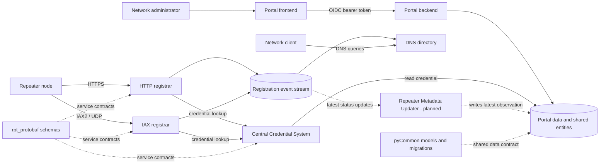

# System architecture

Apt-RPT's documentation covers three cooperating system areas. **Portal** is
the human-facing management plane for Sites, Repeaters, and Entities.
**Registration** authenticates nodes and publishes their observed endpoints.
**Discovery** helps clients find currently reachable repeaters. A network may
deploy each area on its own schedule.

Portal stores canonical Site and Repeater records, including each Repeater's
Node ID and administrative enablement. Registrars authenticate a node using its
Node ID and password, then publish the observed endpoint and registration time.
The directory exposes valid current registrations through DNS. The planned
updater bridges the event stream back to Portal's latest-status fields; it is a
separate project from the web services, and its source visibility remains
undecided.

## Project guides

- [Portal overview](portal/index.md), [backend](projects/portal/backend.md), and [frontend](projects/portal/frontend.md)
- [DNS directory](projects/dns/index.md)
- [HTTP registrar](projects/http/index.md)
- [IAX registrar](projects/iax/index.md)
- [Central Credential System](projects/central-auth/index.md)
- [Shared Python models](projects/common/index.md)
- [Shared protobuf library](projects/protobuf/index.md)
