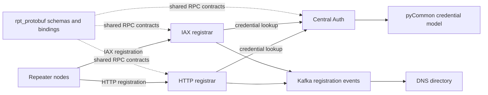

# System components

The registration system has four services and two shared libraries. Registration
clients call the HTTP or IAX registrar; the DNS service publishes directory
records from registration events. Both registrars can validate credentials from a
local file or use Central Auth over gRPC. Central Auth reads the credential model
owned by `pyCommon`; all services share protocol definitions from `rpt_protobuf`.

Each source repository keeps its own standalone documentation. Use this site for
cross-project behavior, then consult a project's repository docs for its
implementation details.

## Project guides

- [DNS directory](projects/dns/index.md)
- [HTTP registrar](projects/http/index.md)
- [IAX registrar](projects/iax/index.md)
- [Central Auth](projects/central-auth/index.md)
- [Shared Python models](projects/common/index.md)
- [Shared protobuf library](projects/protobuf/index.md)
